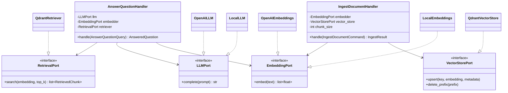
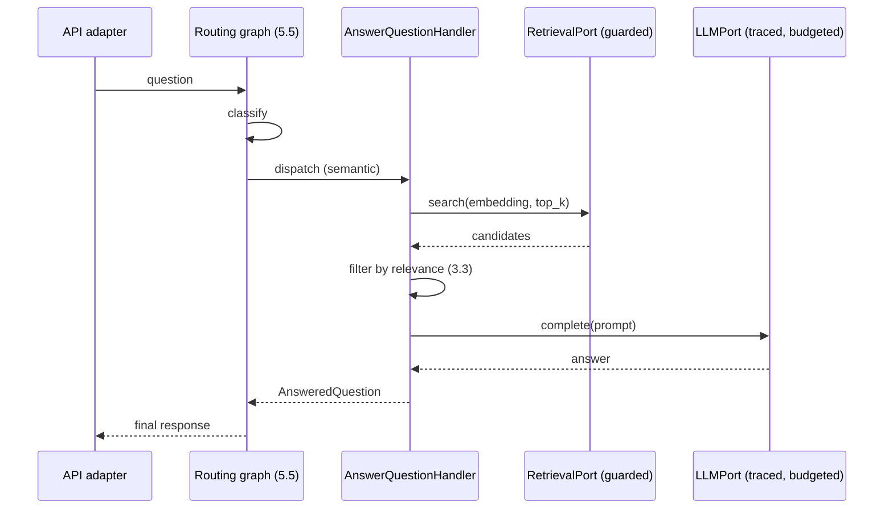
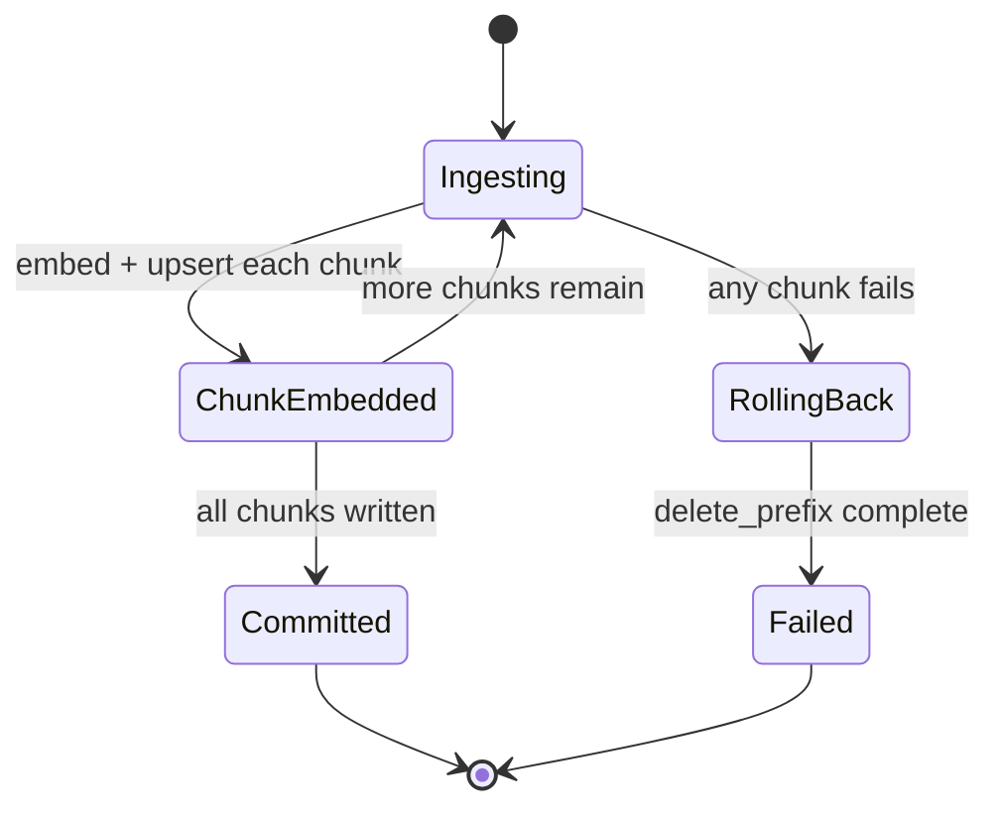

# Architecture diagrams (7.2)

Diagrams as code: each `.mmd` file lives in the repository next to the code it describes, so it is reviewed, diffed and updated with that code. GitHub renders the blocks below.

## Diagram 1 — Package structure (class diagram)

Source: [`01-package-structure.mmd`](01-package-structure.mmd) · Maps to: `app/ports.py`, `app/core/`, `app/adapters/`. Notice what has no arrow: `AnswerQuestionHandler` and `IngestDocumentHandler` share nothing but `EmbeddingPort` — that absence is Part IV.

## Diagram 2 — Request lifecycle (sequence diagram)

Source: [`02-request-lifecycle.mmd`](02-request-lifecycle.mmd) · Maps to: `app/adapters/api/http_handler.py` → `app/adapters/orchestration/` → `app/core/query_handler.py`.

## Diagram 3 — Ingestion state machine

Source: [`03-ingestion-states.mmd`](03-ingestion-states.mmd) · Maps to: `app/core/ingest_handler.py`: there is no path from `Ingesting` to the end state that skips both `Committed` and `Failed`.

